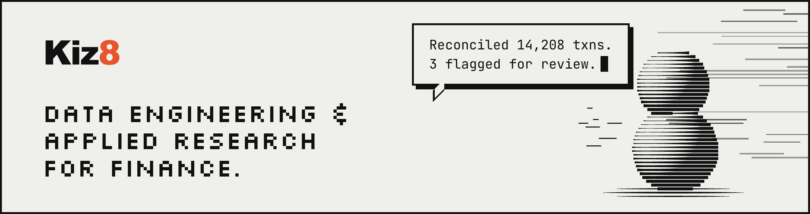
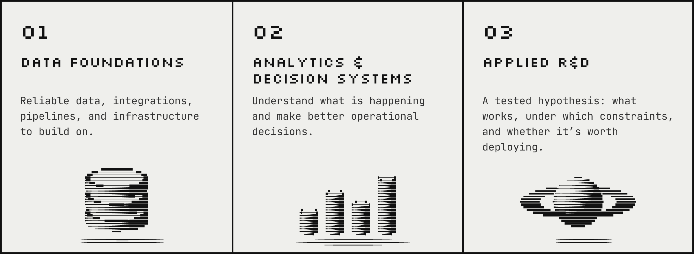
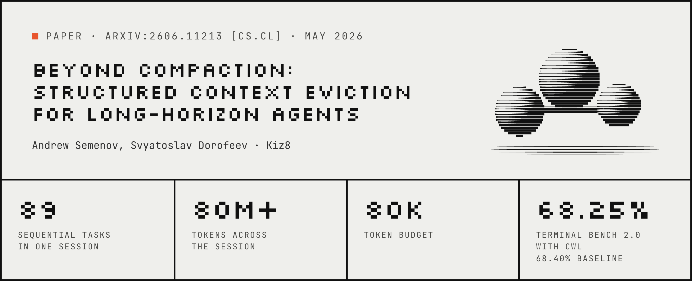

<picture>
  <source media="(prefers-color-scheme: dark)" srcset="./assets/banner-dark.png">
  
</picture>

**Kiz8 is an independent data engineering and applied research studio for the financial industry.**
Engineers and researchers based in Lisbon since 2024: data, analytics, infrastructure, and research under one roof.

[kiz8.com](https://kiz8.com) · [Hugging Face](https://huggingface.co/Kiz8) · [LinkedIn](https://www.linkedin.com/company/kiz8/)

## `01` What clients bring us

<picture>
  <source media="(prefers-color-scheme: dark)" srcset="./assets/expertise-dark.png">
  
</picture>

ML, AI agents, RAG, and automation come in where the problem needs them.

## `02` Research

Problems from practice become research topics. Research improves our methods, and part of it becomes open tools.

<a href="https://arxiv.org/abs/2606.11213">
<picture>
  <source media="(prefers-color-scheme: dark)" srcset="./assets/research-dark.png">
  
</picture>
</a>

**Can one long-running LLM agent keep working once its history outgrows the context window, without summarising that history away?** Context Window Lifecycle (CWL) has the agent annotate its own trajectory as typed, dependency-linked episodes; when the token budget is exceeded, a deterministic policy evicts the oldest and most recoverable content first and never drops context an open action still depends on. One session completed 89 sequential tasks across more than 80 million tokens, with no measurable accuracy loss against fresh per-task sessions.

[Read the paper ↗](https://arxiv.org/abs/2606.11213) · [Code: pi-cwl](https://github.com/Kiz8-Team/pi-cwl)

## `03` Open source

**[pi-cwl](https://github.com/Kiz8-Team/pi-cwl)** · `MIT`
Reference implementation of Context Window Lifecycle: structured context eviction that lets a long-horizon LLM agent keep working past its context window. Built on a fork of the pi.dev terminal coding agent. For engineers building long-running agents who have hit the limits of summarisation-based compaction.

```bash
git clone https://github.com/Kiz8-Team/pi-cwl
cd pi-cwl && npm install && npm run build
pi
```

**[jean-claude-kar-pathy](https://github.com/Kiz8-Team/jean-claude-kar-pathy)** · `Claude Code plugin`
Builds and maintains an LLM-written wiki for any project, after Andrej Karpathy’s LLM Wiki pattern, so session knowledge compounds instead of vanishing when the context is cleared. For teams working with Claude Code who keep re-explaining the same project to every new session.

```bash
git clone https://github.com/Kiz8-Team/jean-claude-kar-pathy
cp jean-claude-kar-pathy/commands/jean.md ~/.claude/commands/jean.md
# then run /jean inside Claude Code
```

## `04` Discuss a project

> **From raw data to better decisions.**
> Send one paragraph about the data, the decision it should support, or the hypothesis you need tested. We reply with what we would look at first.

**[hello@kiz8.com](mailto:hello@kiz8.com)** · [kiz8.com](https://kiz8.com)

<sub>Kiz8 · Lisbon, since 2024 · Every illustration is drawn in code, one scanline at a time.</sub>
